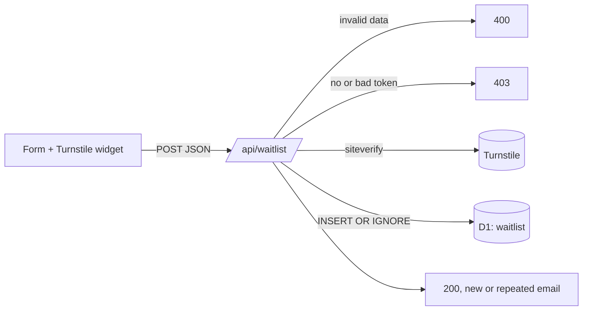

# @wtl/web — landing page and waitlist

Static Astro site deployed on Cloudflare Pages. The waitlist form posts to a Pages Function (`functions/api/waitlist.ts`) that checks Cloudflare Turnstile and stores the sign-up in a D1 database.

| Route | What |
| --- | --- |
| `/` | Landing page (English; `es`, `fr`, `de`, `it` later through Astro i18n routing) |
| `/privacy` | Privacy policy (GDPR). Also the URL for the App Store listing |
| `/demo/` | The Luxembourg prototype, copied from `prototipo/` at build time |
| `POST /api/waitlist` | Waitlist sign-up |

The commercial name is a placeholder: change `SITE_NAME` in `src/config.ts`. Cities and languages offered in the form live in the same file and are shared with the server validation.



## Develop locally

Node 22 and pnpm (see the root `package.json`). From the repo root: `pnpm install`.

```sh
cd apps/web
pnpm dev                     # Astro dev server on http://localhost:4321 (no API)
```

`pnpm dev` and `pnpm build` first run `scripts/copy-demo.mjs`, which copies `prototipo/index.html`, `app.js`, `style.css` and `data/*.js` into `public/demo/` (git-ignored).

To exercise the form end to end you need the Pages runtime with D1:

```sh
cp .dev.vars.example .dev.vars          # Turnstile test secret (always passes)
pnpm db:migrate:local                   # creates the table in .wrangler/state
pnpm build
pnpm preview                            # wrangler pages dev → http://localhost:8788
```

In development the page uses Cloudflare's test site key `1x00000000000000000000AA`, so the widget always passes. To test a rejection, set `TURNSTILE_SECRET=2x0000000000000000000000000000000AA` in `.dev.vars`.

Check what landed:

```sh
pnpm exec wrangler d1 execute wtl-waitlist --local --command "SELECT * FROM waitlist ORDER BY id DESC LIMIT 20"
```

Checks (also run from the root with `pnpm lint`, `pnpm typecheck`, `pnpm test`):

```sh
pnpm test        # vitest: src/lib/waitlist.ts validation
pnpm typecheck   # astro check + functions with Workers types
pnpm lint
```

## API contract

`POST /api/waitlist` with JSON or form data: `email`, `city` (`luxembourg`, `madrid`, `barcelona`, `paris`, `london`, `berlin`, `rome`, `milan`), `locale` (`en`, `es`, `fr`, `de`, `it`), `consent` (`true`/`on`), `cf-turnstile-response`, optional `source` (`[a-z0-9_-]{1,32}`, defaults to `landing`).

| Status | When |
| --- | --- |
| 200 `{ok:true}` | Stored, or the email was already on the list (the response is the same, so nobody can probe who signed up) |
| 400 `{error:"invalid", fields}` | Bad email, city, locale or missing consent |
| 403 `{error:"captcha"}` | Missing token or Turnstile verification failed |
| 500 `{error:"server"}` | Missing binding/secret or D1 error (logged) |

## Set up Cloudflare (once)

Needs a Cloudflare account and `pnpm exec wrangler login`.

1. **D1 database**

   ```sh
   pnpm exec wrangler d1 create wtl-waitlist --location weur   # keep the data in Western Europe
   ```

   Copy the printed `database_id` into `wrangler.toml`, then apply the migrations:

   ```sh
   pnpm db:migrate:remote
   ```

2. **Turnstile widget**: Dashboard → Turnstile → Add widget. Hostnames: the Pages domain (`<project>.pages.dev`) and the custom domain. Mode: Managed. Keep the site key and the secret.

3. **Pages project**: Dashboard → Workers & Pages → Create → Pages → Connect to Git.
   - Root directory: `apps/web`
   - Build command: `pnpm build` (Pages detects pnpm from the lockfile; set `NODE_VERSION=22`)
   - Build output directory: `dist`
   - Environment variable (build): `PUBLIC_TURNSTILE_SITE_KEY=<site key>`
   - The `DB` binding is read from `wrangler.toml`. If the dashboard does not pick it up, add it under Settings → Bindings → D1 → `DB` → `wtl-waitlist`.

4. **Secret**

   ```sh
   pnpm exec wrangler pages secret put TURNSTILE_SECRET --project-name where-to-live
   ```

5. **Custom domain** (when the name is decided): Pages → Custom domains. Add the domain to the Turnstile widget hostnames and update `SITE_URL` and `CONTACT_EMAIL` in `src/config.ts` and `site` in `astro.config.mjs`.

## Export sign-ups

```sh
# All sign-ups as JSON
pnpm exec wrangler d1 execute wtl-waitlist --remote --json \
  --command "SELECT email, city, locale, consent_at, created_at, source FROM waitlist ORDER BY created_at"

# Count per city
pnpm exec wrangler d1 execute wtl-waitlist --remote \
  --command "SELECT city, COUNT(*) AS n FROM waitlist GROUP BY city ORDER BY n DESC"

# Delete someone who asks (GDPR right to erasure)
pnpm exec wrangler d1 execute wtl-waitlist --remote \
  --command "DELETE FROM waitlist WHERE email = 'person@example.com'"
```

For a full backup: `pnpm exec wrangler d1 export wtl-waitlist --remote --output waitlist.sql` (keep it out of the repo).
