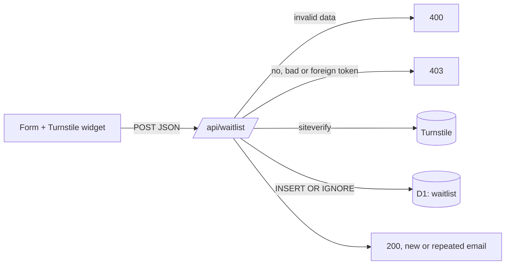

# @wtl/web — landing page and waitlist

Static Astro site deployed on Cloudflare Pages. The waitlist form posts to a Pages Function (`functions/api/waitlist.ts`) that checks Cloudflare Turnstile and stores the sign-up in a D1 database.

| Route | What |
| --- | --- |
| `/` | Landing page (English; `es`, `fr`, `de`, `it` later through Astro i18n routing and `src/i18n/`) |
| `/privacy` | Privacy policy (GDPR). Also the URL for the App Store listing |
| `/demo/` | The Luxembourg prototype, copied from `prototipo/` at build time |
| `POST /api/waitlist` | Waitlist sign-up |

The commercial name is a placeholder: change `SITE_NAME` in `src/config.ts`. Cities and languages offered in the form live in the same file and are shared with the server validation. Copy lives in `src/i18n/en.ts`.



## Develop locally

Node 22 and pnpm (see the root `package.json`). From the repo root: `pnpm install`.

```sh
cd apps/web
pnpm dev                     # Astro dev server on http://localhost:4321 (no API)
```

`pnpm dev` and `pnpm build` first run `scripts/copy-demo.mjs`, which copies `prototipo/index.html`, `app.js`, `style.css` and `data/*.js` into `public/demo/` (git-ignored), then `scripts/build-live-data.mjs`, which runs `prototipo/app.js` in a sandbox to write `public/live/luxembourg.json` (git-ignored): the commute times, rent estimates, noise and distances behind the live map on the home page. The map and the demo therefore share one algorithm and one dataset; if the prototype's code changes shape, this step fails the build instead of drifting.

To exercise the form end to end you need the Pages runtime with D1:

```sh
cp .dev.vars.example .dev.vars          # Turnstile test secret (always passes), no hostname check
pnpm db:migrate:local                   # creates the table in .wrangler/state
pnpm build
pnpm preview                            # wrangler pages dev → http://localhost:8788
```

In development the page uses Cloudflare's test site key `1x00000000000000000000AA`, so the widget always passes. To test a rejection, set `TURNSTILE_SECRET=2x0000000000000000000000000000000AA` in `.dev.vars` and restart `pnpm preview`.

Check what landed:

```sh
pnpm exec wrangler d1 execute wtl-waitlist --local --command "SELECT * FROM waitlist ORDER BY id DESC LIMIT 20"
```

Checks (also run from the root with `pnpm lint`, `pnpm typecheck`, `pnpm test`):

```sh
pnpm test        # vitest: src/lib/waitlist.ts validation and Turnstile checks
pnpm typecheck   # astro check + functions with Workers types
pnpm lint
```

## API contract

`POST /api/waitlist` with JSON or `application/x-www-form-urlencoded` (max 4 KB): `email`, `city` (`luxembourg`, `madrid`, `barcelona`, `paris`, `london`, `berlin`, `rome`, `milan`), `locale` (`en`, `es`, `fr`, `de`, `it`), `consent` (`true`/`on`), `cf-turnstile-response`, optional `source` (`[a-z0-9_-]{1,32}`, defaults to `landing`; the page fills it from `?ref=`).

| Status | When |
| --- | --- |
| 200 `{ok:true}` | Stored, or the email was already on the list (same response, so nobody can probe who signed up). A repeated email keeps its first city and language |
| 400 `{error:"invalid", fields}` | Bad email, city, locale, missing consent, or an unsupported body |
| 403 `{error:"captcha"}` | Missing token, failed verification, or (in production) a token from another hostname, another action or a test key |
| 413 `{error:"too-large"}` | Body over 4 KB |
| 500 `{error:"server"}` | Missing binding/secret or D1 error (logged) |

Each row stores `policy_version` (`PRIVACY_VERSION` in `src/config.ts`): the date of the privacy policy the person agreed to. Bump it whenever `/privacy` changes in substance.

## Set up Cloudflare (once)

Needs a Cloudflare account and `pnpm exec wrangler login`. None of this has been run yet.

1. **D1 databases** (the EU jurisdiction keeps the data in the EU, as `/privacy` says)

   ```sh
   pnpm exec wrangler d1 create wtl-waitlist --jurisdiction eu
   pnpm exec wrangler d1 create wtl-waitlist-preview --jurisdiction eu
   ```

   Put both printed ids in `wrangler.toml` (production at the top, preview under `env.preview`) and **commit them before the first deploy**. With `pages_build_output_dir` set, Pages reads bindings from `wrangler.toml` only and locks them in the dashboard. Then apply the migrations:

   ```sh
   pnpm db:migrate:remote
   pnpm exec wrangler d1 migrations apply wtl-waitlist-preview --remote
   ```

2. **Turnstile widget**: Dashboard → Turnstile → Add widget. Hostnames: `where-to-live.pages.dev` and the custom domain. Mode: Managed. Keep the site key and the secret.

3. **Pages project**: Dashboard → Workers & Pages → Create → Pages → Connect to Git. Name it **`where-to-live`** (it must match `name` in `wrangler.toml`).
   - Root directory: `apps/web` (so Pages finds `wrangler.toml` and `functions/`)
   - Build command, installing from the monorepo root so the lockfile and `pnpm-workspace.yaml` apply:
     `cd ../.. && pnpm install --frozen-lockfile && pnpm --filter @wtl/web build`
   - Build output directory: `dist`
   - Build variables: `NODE_VERSION=22`, `SKIP_DEPENDENCY_INSTALL=1`, `PUBLIC_TURNSTILE_SITE_KEY=<site key>`
   - Production branch: `main`. A production build fails on purpose while the site key is unset or `CONTACT_EMAIL` / `CONTROLLER` in `src/config.ts` are still placeholders (see `astro.config.mjs`).
   - This monorepo build setup is untested on Pages: check the first build log.

4. **Secrets** (production; for previews add them in Settings → Variables and secrets → Preview)

   ```sh
   pnpm exec wrangler pages secret put TURNSTILE_SECRET --project-name where-to-live
   pnpm exec wrangler pages secret put TURNSTILE_HOSTNAMES --project-name where-to-live
   # value: where-to-live.pages.dev,<custom domain>
   ```

   `TURNSTILE_HOSTNAMES` makes the API reject tokens from other sites and from Cloudflare's test keys, so a test secret pasted into production cannot open the list to bots.

5. **Custom domain** (when the name is decided): Pages → Custom domains. Add the domain to the Turnstile widget and to `TURNSTILE_HOSTNAMES`, and update `SITE_URL` and `CONTACT_EMAIL` in `src/config.ts` and `site` in `astro.config.mjs`.

## Export sign-ups

```sh
# All sign-ups as JSON
pnpm exec wrangler d1 execute wtl-waitlist --remote --json \
  --command "SELECT email, city, locale, consent_at, created_at, source, policy_version FROM waitlist ORDER BY created_at"

# Count per city
pnpm exec wrangler d1 execute wtl-waitlist --remote \
  --command "SELECT city, COUNT(*) AS n FROM waitlist GROUP BY city ORDER BY n DESC"
```

For a full backup: `pnpm exec wrangler d1 export wtl-waitlist --remote --output waitlist.sql` (keep it out of the repo).

## Privacy duties

`/privacy` promises these. They are manual until there is tooling:

- **Erasure or unsubscribe on request**:

  ```sh
  pnpm exec wrangler d1 execute wtl-waitlist --remote \
    --command "DELETE FROM waitlist WHERE email = 'person@example.com'"
  ```

- **Monthly purge** of entries older than 24 months:

  ```sh
  pnpm exec wrangler d1 execute wtl-waitlist --remote \
    --command "DELETE FROM waitlist WHERE created_at < strftime('%Y-%m-%dT%H:%M:%fZ', 'now', '-24 months')"
  ```

- **Every email to the list carries an unsubscribe link.** Before the first launch email, consider a confirmation email (double opt-in) so consent is provable for the address owner.
